# Smart Device Platform — demonstrator

[](https://github.com/ikhemissi/smart-device-platform-sample/actions/workflows/ci.yml)

**From sensor bytes to decisions, on Azure.** A complete, deployable sample of an IoT platform: devices send binary measurements; the platform stores them reliably, shows them to the right people and alerts on thresholds — and uses AI to tell people what deserves their attention: unusual readings, a daily brief per site, and the devices to visit before their battery dies.

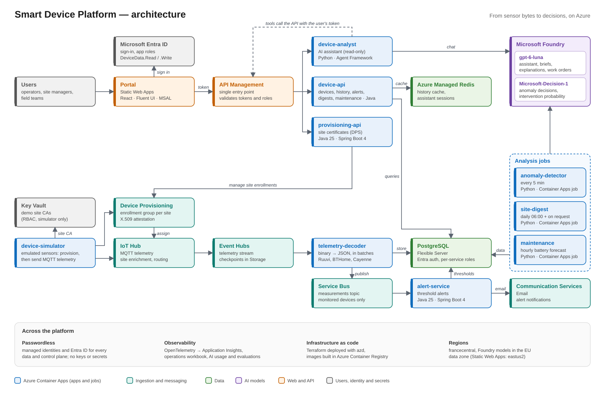

**Contents:** [Why it matters](#why-it-matters) · [What it shows](#what-it-shows) · [Architecture](#architecture) · [How it works](#how-it-works) · [Security](#security) · [Repository](#repository) · [Build and test](#build-and-test) · [Continuous integration](#continuous-integration) · [Deploy to Azure](#deploy-to-azure) · [Operate](#operate) · [Contributing](#contributing)

## Why it matters

| For… | The platform… | So that… |
|---|---|---|
| **Operators** | alerts on thresholds without flooding inboxes, and flags unusual readings nobody configured, saying how sure it is | they act on real problems, not on noise |
| **Site managers** | writes a short daily brief per site from figures it computes | they know a site's state at a glance |
| **Field teams** | forecasts every battery and ranks the devices likely to need a visit within 7 days, with a work order | visits are planned before devices go silent |
| **Everyone** | answers questions in plain language, grounded in the data, with sources and within the user's permissions | data is useful without dashboards or SQL |
| **Architects** | wires Azure building blocks end to end: passwordless, observable, deployed with one command, specified and tested | they reuse working patterns, not slideware |

### AI you can trust

- **Code computes, models judge, language models write** ([ADR-0011](docs/adr/ADR-0011-model-based-analysis.md)): statistics and figures are computed in code; `Microsoft-Decision-1` returns a probability for a closed question; `gpt-6-luna` only puts computed figures into words, and every number it writes is checked against them.
- **Thresholds are settings tuned on real data** with dry runs that write nothing, and every automated decision is recorded with its probabilities, threshold and model version.
- **People stay in charge:** Editors review anomalies and close maintenance items; the assistant is read-only and sees only what the signed-in user may see.

## What it shows

| # | Capability | Highlights | Demo guide |
|---|---|---|---|
| M1 | Device data is stored | X.509 devices per site, IoT Hub → Event Hubs → batch decoder → PostgreSQL, 4 real payload formats | [m1-ingestion](docs/demo/m1-ingestion.md) |
| M2 | Device list in the web portal | Entra ID sign-in, Read/Write roles, API Management | [m2-device-list](docs/demo/m2-device-list.md) |
| M3 | Device data and chart | Latest 20 measurements, chart up to 30 days, Redis cache | [m3-device-data-and-chart](docs/demo/m3-device-data-and-chart.md) |
| M4 | Site certificates | Add or remove a site's CA certificates in DPS from the portal | [m4-site-certificates](docs/demo/m4-site-certificates.md) |
| M5 | Threshold alerting | Thresholds per device, emails without floods, alert history | [m5-threshold-alerting](docs/demo/m5-threshold-alerting.md) |
| M6 | AI assistant | Questions in natural language, grounded answers with sources, `gpt-6-luna` | [m6-ai-analyst](docs/demo/m6-ai-analyst.md) |
| M7 | Anomaly detection | Statistics select, `Microsoft-Decision-1` classifies (real event, sensor fault, …) with a confidence, `gpt-6-luna` explains; reviews in the portal | [m7-anomaly-detection](docs/demo/m7-anomaly-detection.md) |
| M8 | Site digest | A daily brief per site written by `gpt-6-luna` from figures the platform computes; regenerated on request | [m8-site-digest](docs/demo/m8-site-digest.md) |
| M9 | Predictive maintenance | Battery forecasts and reporting signals computed in code, `Microsoft-Decision-1` gives the probability of a visit within 7 days, `gpt-6-luna` writes the work order; a maintenance queue in the portal | [m9-maintenance](docs/demo/m9-maintenance.md) |
| — | Operations workbook | KPIs, latest errors, AI assistant usage, PostgreSQL / IoT Hub / Event Hubs metrics | [Operate](#operate) |

## Architecture

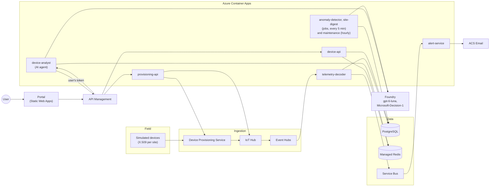

| Layer | Technology |
|---|---|
| Platform services | Java 25, Spring Boot 4 |
| AI agent and analysis jobs | Python 3.13, Microsoft Agent Framework, Foundry (`gpt-6-luna`, `Microsoft-Decision-1`, EU data zone) |
| Portal | React, TypeScript, Fluent UI, MSAL, on Azure Static Web Apps |
| Infrastructure | Terraform, deployed with azd |
| Observability | OpenTelemetry → Application Insights, Azure Monitor workbook |
| Region | `francecentral` (Static Web Apps: `eastus2`, `westeurope` being blocked by tenant policy) |

Design decisions: [ADRs](docs/adr/README.md) (hard to reverse) and [implementation guidelines](docs/architecture/implementation-guidelines.md) (reversible conventions).

## How it works

### 1. Devices send measurements (M1)

Each device holds a certificate signed by its site's CA. It joins through DPS, sends binary payloads to IoT Hub, and the decoder stores them in batches.

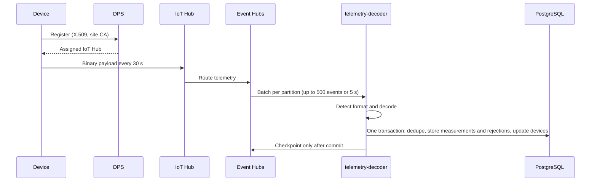

- **Formats:** Ruuvi DF5 and DF3, BTHome v2, Cayenne LPP, decoded into canonical metrics with fixed units.
- **Never lost, never doubled:** a batch is checkpointed only after it is stored, and a ledger of message keys removes duplicates.
- **Bad messages** become *rejected messages* with a reason; they never block a batch.

### 2. People browse devices and history (M2, M3)

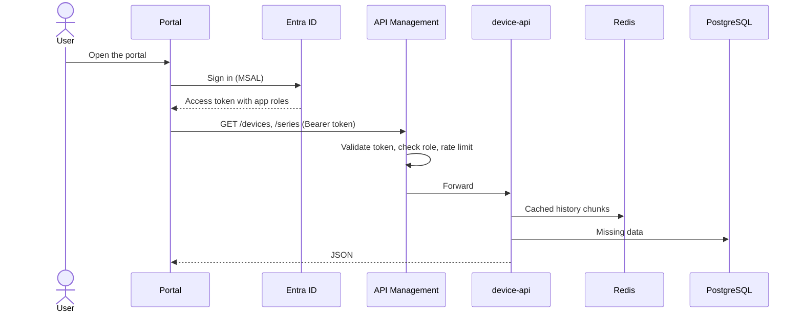

- Two app roles: **DeviceData.Read** (query) and **DeviceData.Write** (edit device names, thresholds, certificates).
- Charts pick their resolution (raw, 1 min … 1 day buckets); complete history chunks are cached in Redis.

### 3. Editors control which devices may connect (M4)

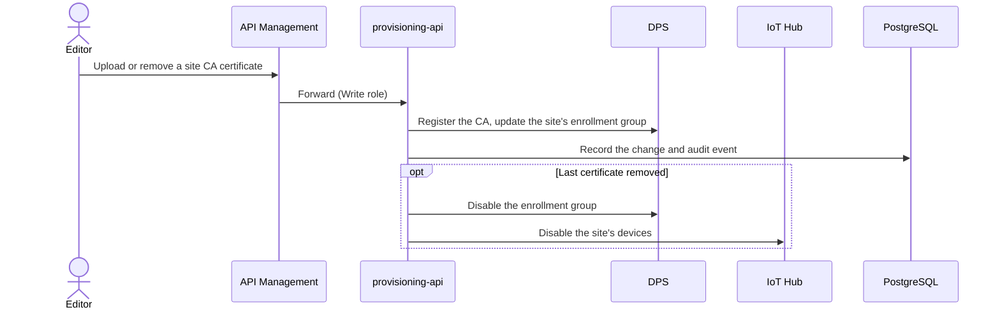

- DPS is the source of truth; an hourly reconciliation brings the database back in line.
- Adding a certificate again re-enables only the devices the platform disabled.

### 4. Threshold alerts by email (M5)

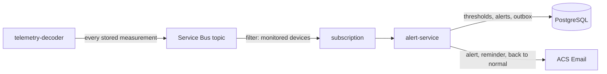

- **One alert per breach:** an email when it opens, a reminder after 60 minutes, and one when it is back to normal.
- **Reliable:** emails are written in the alert's transaction (outbox) and sent with retries; a redelivered message never sends a second email.
- **Monitored devices** are configuration (`ALERTING_SUBSCRIPTION_FILTER`), not code.

### 5. AI assistant (M6)

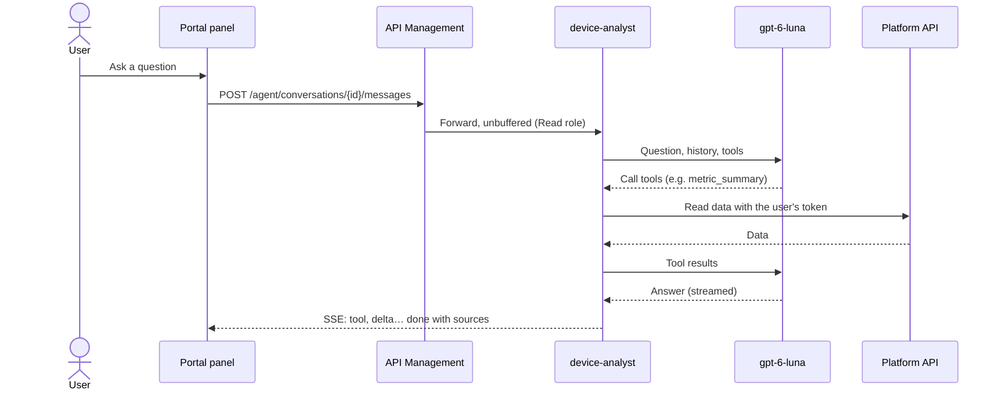

- **Grounded and read-only:** read-only tools (plus anomalies, site digests and the maintenance queue where they run); the assistant can never see more than the user and declines to change anything.
- **Conversations** live in Redis, belong to their author and expire after an hour.
- **Quality is measured:** an evaluation set of 17 questions scored for groundedness, relevance and tool use; first text within 5 s for all of them ([agent README](agents/device-analyst/README.md#evaluation)).

### 6. Anomaly detection (M7)

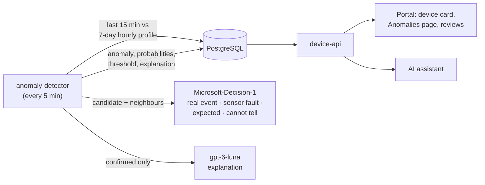

- **Statistics select, the decision model decides, the LLM explains** ([ADR-0011](docs/adr/ADR-0011-model-based-analysis.md)): readings far from the device's usual value for that hour, flat lines and jumps become candidates; `Microsoft-Decision-1` gives a probability per class; confirmed anomalies get a short explanation.
- **Status from the confidence** (`ANOMALY_CONFIDENCE`): confirmed, to review (unsure) or dismissed; Editors record whether the classification was correct.
- **Every decision is recorded:** all probabilities, the threshold, the model and its version; a failed model call is retried by the next cycle.
- **Tuned on the environment's data** with dry runs (no write): about 3 candidates and 1.7 confirmed anomalies a day on `paris-01` ([detector README](agents/anomaly-detector/README.md#tuning)).

### 7. Site digests (M8)

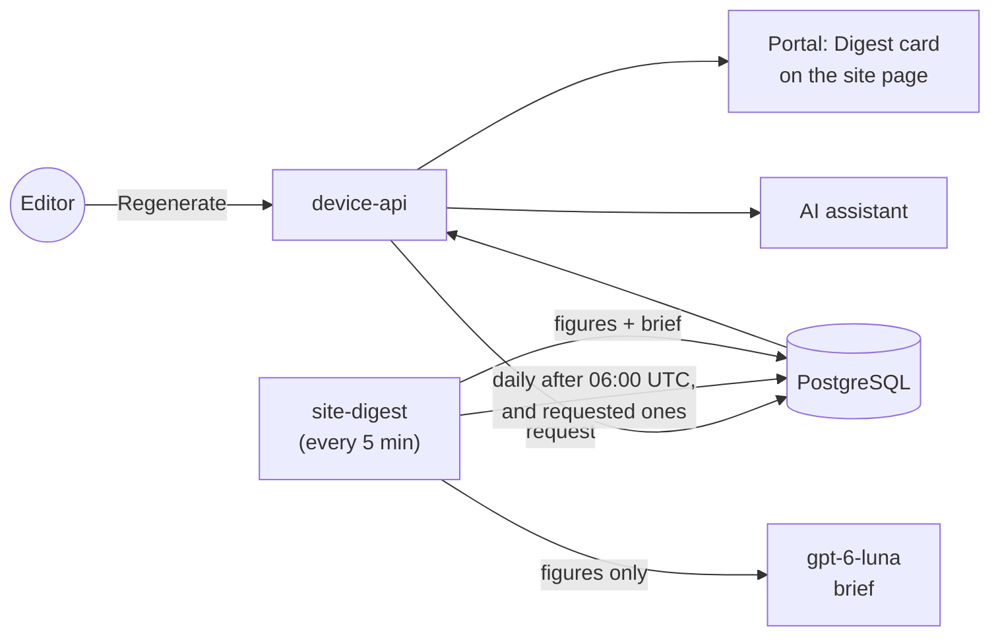

- **Figures computed, text written:** devices reporting and silent, metric averages over the last 24 hours against the 7 days before (batteries excepted: the maintenance queue covers them), alerts, anomalies, rejected messages and expiring certificates are computed in code; the model only writes a few sentences from them, and every number it states is checked against the figures.
- **Regenerate** records a request; the job serves it within 5 minutes, so the device API keeps data-plane access only.
- If the model fails, the figures are shown without a brief and a later run adds it.

### 8. Predictive maintenance (M9)

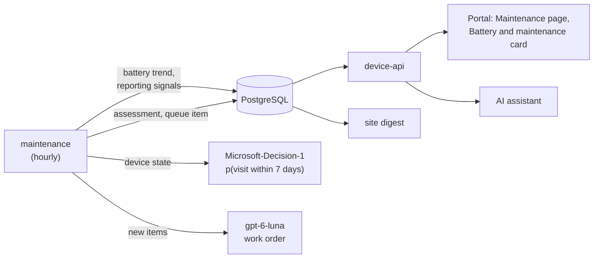

- **Forecast in code:** a weighted trend of each device's hourly battery averages since its last change (a replacement, a smaller step or a steepening of the decline, found by a change-point search) gives the level, the trend per day and the days left before the cut-off (2.5 V or 10 %); reporting signals (gaps, silence, rejected messages) come from SQL.
- **The decision model gives the probability** that the device needs a visit within 7 days; from `MAINTENANCE_CONFIDENCE` the device enters the queue with the reasons that crossed a rule and a short work order. Items leave the queue when the probability falls (resolved) or when an Editor marks the visit done; *Planned* records an intervention being organised.
- **Everywhere the data is used:** the queue is in the portal (page and device card), in the assistant (`list_maintenance`) and in the site digest's figures.
- **Demo devices age:** the simulator drains the battery of `<site>-ruuvi5-003` in about two weeks, then replaces it (`SIMULATOR_AGING_DEVICES`).

### 9. Observability

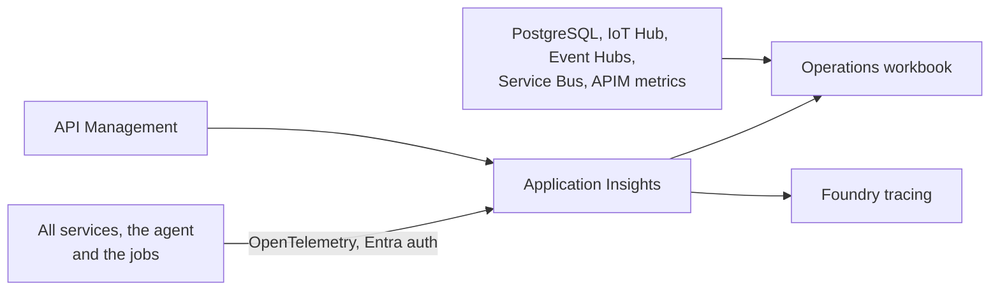

One trace follows a device message from the decoder to the alert email, and a question from the portal through the agent, the model, the gateway and the database.

## Security

| Principle | How |
|---|---|
| Passwordless | Managed identities and Entra ID everywhere; keys and local auth disabled (PostgreSQL, Redis, Service Bus, Storage, Foundry, App Insights) |
| No secrets | Nothing in code, configuration, IaC outputs or CI ([ADR-0005](docs/adr/ADR-0005-passwordless-identity.md)) |
| Device identity | X.509 certificates per site CA, enrolled in DPS ([ADR-0006](docs/adr/ADR-0006-device-identity-per-site-ca.md)) |
| User access | Entra ID app roles, checked by API Management **and** by each service |
| AI access | Models reached with workload identities (no keys); the assistant calls the platform API with the user's token, read-only |
| Least privilege | One identity per workload with data-plane roles only |

Details: [docs/security.md](docs/security.md). All resources carry the tenant tags `SecurityControl=Ignore` and `CostControl=Ignore`.

## Repository

| Path | Content |
|---|---|
| `services/` | Java services: `telemetry-decoder`, `device-simulator`, `device-api`, `provisioning-api`, `alert-service`, `db-migrator` (each with a README) |
| `agents/device-analyst/` | AI agent and its evaluation set |
| `agents/anomaly-detector/` | Model-based analysis jobs: anomaly detection (statistics, decision model, explanations), site digests and predictive maintenance |
| `web/portal/` | Web portal |
| `libs/` | Shared Java libraries: payload codecs, simulated fleet, security/observability, database schema, test support |
| `infra/` | Terraform (deployed with azd) |
| `scripts/` | Deployment hooks and helper scripts |
| `docs/` | PRDs, ADRs, implementation guidelines, demo guides, security |
| `openspec/` | Specifications and change history |

## Build and test

**Prerequisites:** JDK 25, Podman (or Docker), Node.js 22+, Python 3.13 with [uv](https://docs.astral.sh/uv/), and for deployment Azure CLI (with the `azure-iot` extension), azd, Terraform, OpenSSL.

With Podman, expose its socket to Testcontainers:

```bash
systemctl --user enable --now podman.socket
export DOCKER_HOST=unix:///run/user/$(id -u)/podman/podman.sock TESTCONTAINERS_RYUK_DISABLED=true
```

| Part | Command |
|---|---|
| Java unit tests | `./mvnw test` |
| Java unit + integration tests (Testcontainers) | `./mvnw verify` |
| Portal | `cd web/portal && npm ci && npm run lint && npm test && npm run build` |
| Portal end-to-end (API faked) | `cd web/portal && npm run e2e:podman` |
| AI agent | `cd agents/device-analyst && uv sync && uv run ruff check src tests && uv run pytest` |
| Anomaly detector, site digest and maintenance | `cd agents/anomaly-detector && uv sync && uv run ruff check src tests && uv run pytest` (dry runs: `uv run anomaly-detector --dry-run --days 7`, `uv run site-digest --dry-run --site paris-01`, `uv run maintenance --dry-run --site paris-01 --no-models`) |
| Infrastructure | `terraform -chdir=infra fmt -check -recursive && terraform -chdir=infra validate` |
| Local database | `scripts/local-postgres.sh start && scripts/run-migrations.sh --local` |

## Continuous integration

Every push to `main` and every pull request targeting it runs [`.github/workflows/ci.yml`](.github/workflows/ci.yml) (also startable by hand from the Actions tab). Jobs run in parallel; the commit gets one overall status.

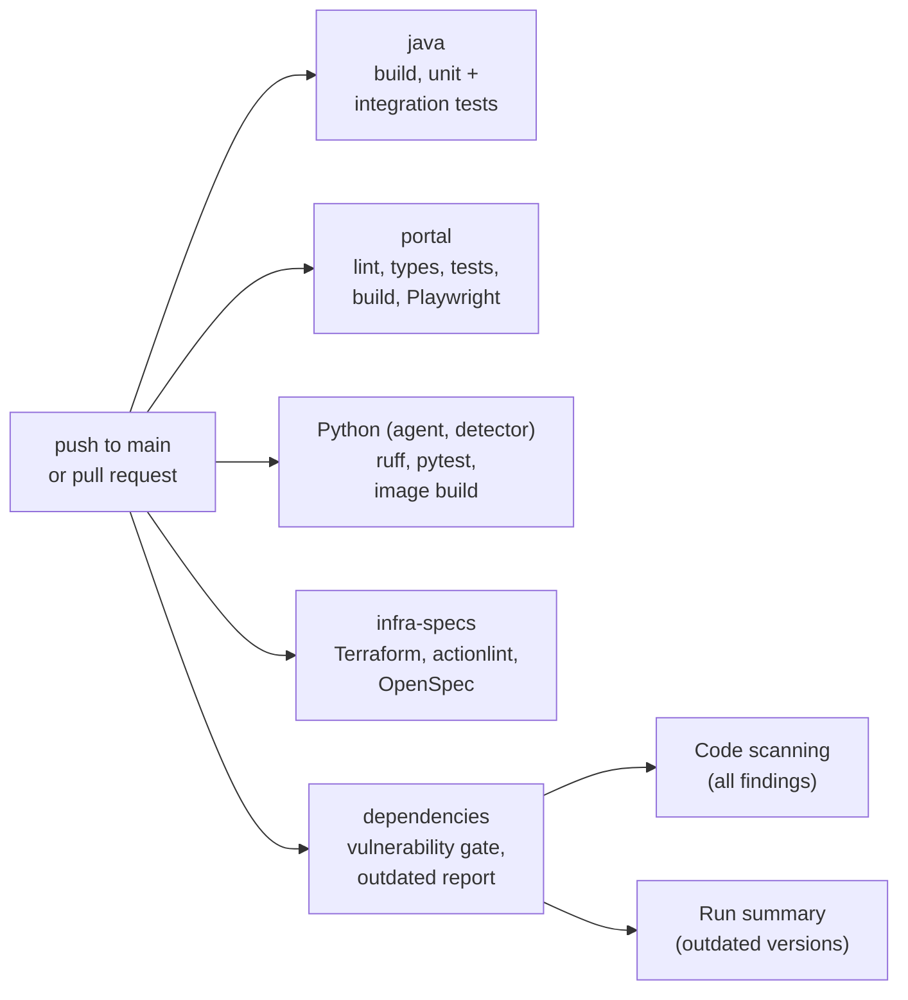

| Job | Checks | Run it locally |
|---|---|---|
| `java` | Build, unit and integration tests (Testcontainers: PostgreSQL, Event Hubs and Service Bus emulators) | `./mvnw verify` |
| `portal` | Lint, type check, unit tests, production build, end-to-end tests with the API faked | `cd web/portal && npm ci && npm run lint && npx tsc -b && npm test && npm run build && npm run e2e:podman` |
| `agent` (matrix: `device-analyst`, `anomaly-detector`) | Ruff lint and format, tests, image build | `cd agents/device-analyst && uv sync --locked && uv run ruff check src tests evals && uv run ruff format --check src tests evals && uv run pytest` (same in `agents/anomaly-detector` with `src tests`) |
| `infra-specs` | Terraform format and validation (no Azure access), workflow lint, OpenSpec strict validation | `terraform -chdir=infra fmt -check -recursive && terraform -chdir=infra init -backend=false && terraform -chdir=infra validate`, `actionlint`, `openspec validate --all --strict` |
| `dependencies` | Vulnerability gate and outdated report | `scripts/scan-vulnerabilities.sh`, `scripts/report-outdated.sh` |

- **No secrets, no Azure access:** only the built-in `GITHUB_TOKEN`, read-only except for publishing code scanning results. Third-party actions are pinned to commit SHAs.
- **Vulnerability policy:** the run fails on **High or Critical** findings that have a fixed version, in the Maven, npm and Python lock files and in the shipped images (Java runtime base image, AI agent and anomaly detector images). All findings, including lower severities and unfixed ones, are listed in the repository's **Security → Code scanning** tab. To accept a finding temporarily, add it to [`.trivyignore.yaml`](.trivyignore.yaml) with a justification and an expiry date; after that date it fails the run again.
- **Outdated dependencies:** newer stable versions of direct dependencies (Maven, npm, Python, Terraform providers, actions) are listed in each run's summary. This report never fails the run.

## Deploy to Azure

**Needs:** Owner (or Contributor + User Access Administrator) on the subscription. No local container engine: images are built in Azure Container Registry.

```bash
az login && azd auth login
azd env new sdp-dev --location francecentral --subscription <subscription-id>
azd up
```

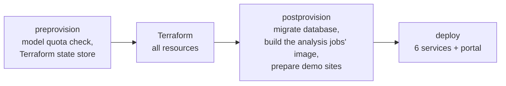

- The simulator starts at once: 3 sites × 10 devices, every 30 s.
- `azd up` is idempotent; `azd deploy <service>` redeploys one service; `azd provision --preview` shows the plan.
- `azd down --purge` removes everything.

**Settings** (`azd env set <name> <value>`, then `azd provision`):

| Setting | Default | Effect |
|---|---|---|
| `ALERTING_SUBSCRIPTION_FILTER` | `siteId = 'paris-01'` | Devices monitored for alerts, e.g. `siteId IN ('paris-01','lyon-01')` |
| `AGENT_MODEL_NAME` / `AGENT_MODEL_VERSION` | `gpt-6-luna` / `2026-09-22` | AI assistant model |
| `AGENT_MODEL_SKU` / `AGENT_MODEL_CAPACITY` | `DataZoneStandard` / `50` | Deployment SKU (EU data zone) and thousands of tokens per minute |
| `AGENT_CAPTURE_CONTENT` | `false` | `true` records prompts and answers in traces (demos only) |
| `PORTAL_ASSISTANT` | on when the agent is deployed | `false` hides the Assistant button |
| `ANOMALY_DETECTION_ENABLED` | `true` | `false` removes the detector job and the `Microsoft-Decision-1` deployment (data kept) |
| `ANOMALY_SITES` | `paris-01` | Sites analysed for anomalies (comma-separated) |
| `ANOMALY_METRICS` | `temperature,humidity,pressure,co2,illuminance` | Metrics analysed |
| `ANOMALY_DEVIATION` / `ANOMALY_CONFIDENCE` | `4` / `0.7` | Distance from the usual value that makes a candidate; probability from which a classification is applied without review |
| `DECISION_MODEL_CAPACITY` | `30` | `Microsoft-Decision-1` capacity (1 request and 1,000 tokens per minute per unit) |
| `PORTAL_ANOMALIES` | on when the detector is deployed | `false` hides the anomaly card and page |
| `DIGEST_ENABLED` | `true` | `false` removes the site digest job; the portal card and the assistant tool follow |
| `DIGEST_SITES` | every site | Sites that get a daily digest (comma-separated) |
| `DIGEST_METRICS` | `temperature,humidity,pressure,co2,illuminance` | Metrics compared in digests (batteries are covered by the maintenance figures) |
| `PORTAL_DIGESTS` | on when the digest job is deployed | `false` hides the Digest card |
| `MAINTENANCE_ENABLED` | `true` | `false` removes the maintenance job; the portal, the assistant tool and the digest figures follow (data kept) |
| `MAINTENANCE_SITES` | every site | Sites assessed for maintenance (comma-separated) |
| `MAINTENANCE_CONFIDENCE` | `0.4` | Probability of a visit within 7 days from which a device enters the queue |
| `SIMULATOR_AGING_DEVICES` | `<site>-ruuvi5-003` per demo site | Simulated devices whose battery drains in about two weeks |
| `PORTAL_MAINTENANCE` | on when the maintenance job is deployed | `false` hides the Maintenance page and the device page's *Battery and maintenance* card |

## Operate

- **Operations workbook** *Smart Device Platform — operations*: devices reporting, measurements, ingestion latency, API traffic and errors, cache, alerts, latest errors, the metrics of PostgreSQL, IoT Hub, Event Hubs, Service Bus and API Management, and an **AI assistant** section (questions, users, time to first text, tokens, tool usage, failures and rate limiting). Filters: time range, site, device type, device. Open it with `azd env get-value OPERATIONS_WORKBOOK_URL`.

| Script | Purpose |
|---|---|
| `scripts/psql.sh` | PostgreSQL with your Entra identity |
| `scripts/trace-device.sh` | Follow a device's messages in Application Insights |
| `scripts/backfill-history.sh` | One-off 30-day demo history |
| `scripts/check-workbook-queries.sh` | Run the workbook's queries against the environment |
| `scripts/remove-test-site.sh` | Remove a `test-*` / `e2e-*` site and everything attached |
| `scripts/agent-env.sh` | Write the AI agent's local `.env` from the azd environment |
| `scripts/anomaly-env.sh` | Write the local `.env` of the anomaly detector, site digest and maintenance jobs (dry runs with your identity) |
| `scripts/build-anomaly-detector-image.sh` | Build the detector image in ACR and point the anomaly, digest and maintenance jobs at it (also run by `postprovision`) |

## Contributing

- **Spec-driven:** every functional change is an [OpenSpec](https://github.com/Fission-AI/OpenSpec) change (propose → apply → archive). Install the CLI with `npm i -g @fission-ai/openspec`; in GitHub Copilot use `/opsx-propose`, `/opsx-apply` and `/opsx-archive`.
- **Coding agents** follow [AGENTS.md](AGENTS.md). Offline work (code and tests) can be delegated to the GitHub Copilot cloud agent, whose environment is [`copilot-setup-steps.yml`](.github/workflows/copilot-setup-steps.yml); tasks needing Azure stay with a session that can reach the environment (see [M9](openspec/changes/archive/2026-10-31-m9-maintenance/tasks.md) for an example).

| Document | Purpose |
|---|---|
| [docs/prd](docs/prd/PRD-000-product-overview.md) | Business requirements and milestones |
| [docs/adr](docs/adr/README.md) | Hard-to-reverse architecture decisions |
| [docs/architecture](docs/architecture/implementation-guidelines.md) | Reversible, cross-cutting conventions |
| [openspec/specs](openspec/specs) | Current specifications |
| [docs/ideas](docs/ideas/smart-platform.md) | Brainstorm: LLMs and decision models for anomalies, maintenance, alerting and site insights |
