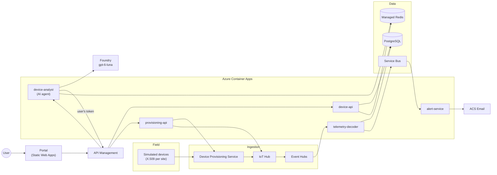
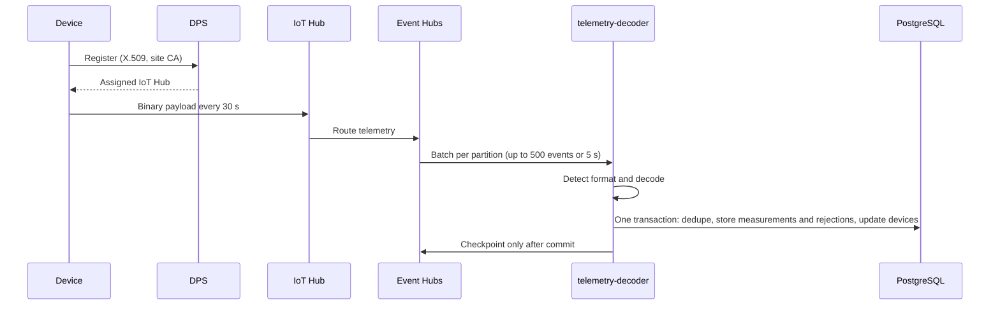
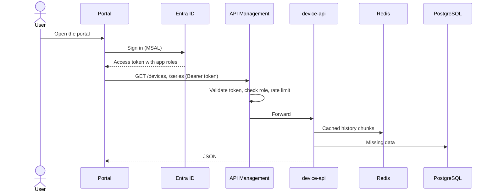
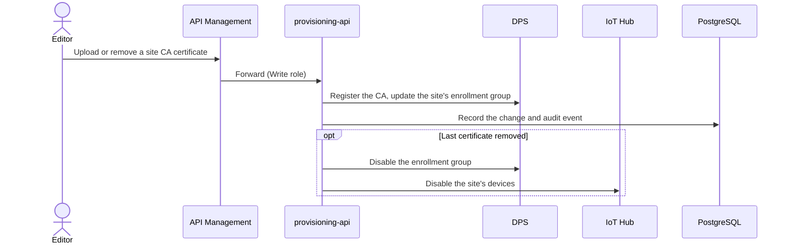
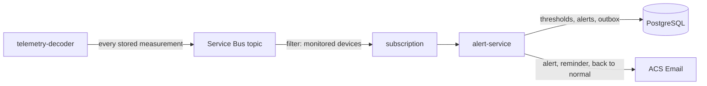
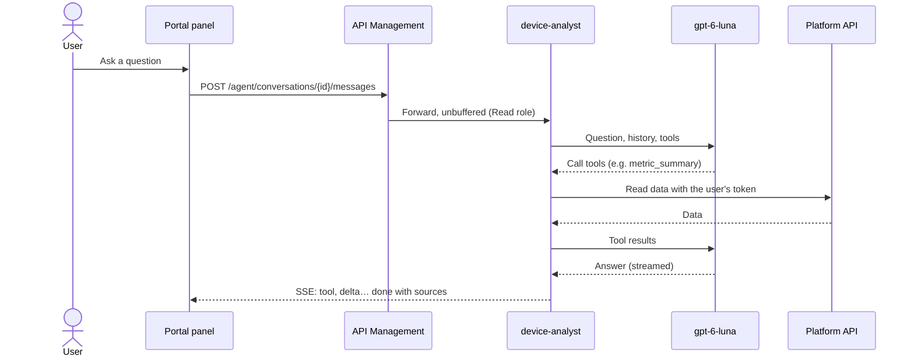
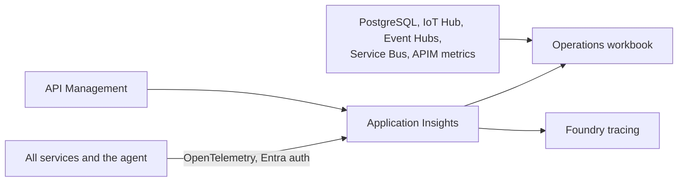
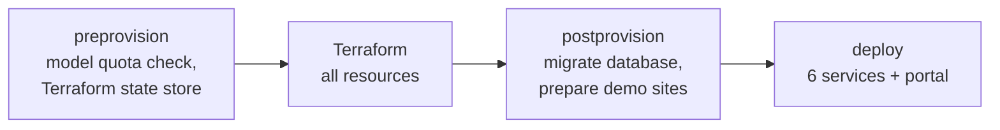

# Smart Device Platform — demonstrator

An end-to-end Azure sample of a sensor platform. Simulated devices send binary measurements, the platform decodes and stores them, people browse them in a web portal, get email alerts, manage which devices may connect, and ask an AI assistant about the data.

> **Status:** all milestones (M1–M6) and the operations workbook are delivered and archived. Baseline specifications are in [`openspec/specs/`](openspec/specs).

**Contents:** [What it shows](#what-it-shows) · [Architecture](#architecture) · [How it works](#how-it-works) · [Security](#security) · [Repository](#repository) · [Build and test](#build-and-test) · [Deploy to Azure](#deploy-to-azure) · [Operate](#operate) · [Contributing](#contributing)

## What it shows

| # | Capability | Highlights | Demo guide |
|---|---|---|---|
| M1 | Device data is stored | X.509 devices per site, IoT Hub → Event Hubs → batch decoder → PostgreSQL, 4 real payload formats | [m1-ingestion](docs/demo/m1-ingestion.md) |
| M2 | Device list in the web portal | Entra ID sign-in, Read/Write roles, API Management | [m2-device-list](docs/demo/m2-device-list.md) |
| M3 | Device data and chart | Latest 20 measurements, chart up to 30 days, Redis cache | [m3-device-data-and-chart](docs/demo/m3-device-data-and-chart.md) |
| M4 | Site certificates | Add or remove a site's CA certificates in DPS from the portal | [m4-site-certificates](docs/demo/m4-site-certificates.md) |
| M5 | Threshold alerting | Thresholds per device, emails without floods, alert history | [m5-threshold-alerting](docs/demo/m5-threshold-alerting.md) |
| — | Operations workbook | KPIs, latest errors, PostgreSQL / IoT Hub / Event Hubs metrics | [Operate](#operate) |
| M6 | AI assistant | Questions in natural language, grounded answers with sources, `gpt-6-luna` | [m6-ai-analyst](docs/demo/m6-ai-analyst.md) |

## Architecture



| Layer | Technology |
|---|---|
| Platform services | Java 25, Spring Boot 4 |
| AI agent | Python 3.13, Microsoft Agent Framework, Foundry (`gpt-6-luna`, EU data zone) |
| Portal | React, TypeScript, Fluent UI, MSAL, on Azure Static Web Apps |
| Infrastructure | Terraform, deployed with azd |
| Observability | OpenTelemetry → Application Insights, Azure Monitor workbook |
| Region | `francecentral` (Static Web Apps: `eastus2`, `westeurope` being blocked by tenant policy) |

Design decisions: [ADRs](docs/adr/README.md) (hard to reverse) and [implementation guidelines](docs/architecture/implementation-guidelines.md) (reversible conventions).

## How it works

### 1. Devices send measurements (M1)

Each device holds a certificate signed by its site's CA. It joins through DPS, sends binary payloads to IoT Hub, and the decoder stores them in batches.



- **Formats:** Ruuvi DF5 and DF3, BTHome v2, Cayenne LPP, decoded into canonical metrics with fixed units.
- **Never lost, never doubled:** a batch is checkpointed only after it is stored, and a ledger of message keys removes duplicates.
- **Bad messages** become *rejected messages* with a reason; they never block a batch.

### 2. People browse devices and history (M2, M3)



- Two app roles: **DeviceData.Read** (query) and **DeviceData.Write** (edit device names, thresholds, certificates).
- Charts pick their resolution (raw, 1 min … 1 day buckets); complete history chunks are cached in Redis.

### 3. Editors control which devices may connect (M4)



- DPS is the source of truth; an hourly reconciliation brings the database back in line.
- Adding a certificate again re-enables only the devices the platform disabled.

### 4. Threshold alerts by email (M5)



- **One alert per breach:** an email when it opens, a reminder after 60 minutes, and one when it is back to normal.
- **Reliable:** emails are written in the alert's transaction (outbox) and sent with retries; a redelivered message never sends a second email.
- **Monitored devices** are configuration (`ALERTING_SUBSCRIPTION_FILTER`), not code.

### 5. AI assistant (M6)



- **Grounded and read-only:** nine read-only tools; the assistant can never see more than the user and declines to change anything.
- **Conversations** live in Redis, belong to their author and expire after an hour.
- **Quality is measured:** an evaluation set of 17 questions scored for groundedness, relevance and tool use; first text within 5 s for all of them ([agent README](agents/device-analyst/README.md#evaluation)).

### 6. Observability



One trace follows a device message from the decoder to the alert email, and a question from the portal through the agent, the model, the gateway and the database.

## Security

| Principle | How |
|---|---|
| Passwordless | Managed identities and Entra ID everywhere; keys and local auth disabled (PostgreSQL, Redis, Service Bus, Storage, Foundry, App Insights) |
| No secrets | Nothing in code, configuration, IaC outputs or CI ([ADR-0005](docs/adr/ADR-0005-passwordless-identity.md)) |
| Device identity | X.509 certificates per site CA, enrolled in DPS ([ADR-0006](docs/adr/ADR-0006-device-identity-per-site-ca.md)) |
| User access | Entra ID app roles, checked by API Management **and** by each service |
| Least privilege | One identity per workload with data-plane roles only |

Details: [docs/security.md](docs/security.md). All resources carry the tenant tags `SecurityControl=Ignore` and `CostControl=Ignore`.

## Repository

| Path | Content |
|---|---|
| `services/` | Java services: `telemetry-decoder`, `device-simulator`, `device-api`, `provisioning-api`, `alert-service`, `db-migrator` (each with a README) |
| `agents/device-analyst/` | AI agent and its evaluation set |
| `web/portal/` | Web portal |
| `libs/` | Shared Java libraries: payload codecs, simulated fleet, security/observability, database schema, test support |
| `infra/` | Terraform (deployed with azd) |
| `scripts/` | Deployment hooks and helper scripts |
| `docs/` | PRDs, ADRs, implementation guidelines, demo guides, security |
| `openspec/` | Specifications and change history |

## Build and test

**Prerequisites:** JDK 25, Podman (or Docker), Node.js 22+, Python 3.13 with [uv](https://docs.astral.sh/uv/), and for deployment Azure CLI (with the `azure-iot` extension), azd, Terraform, OpenSSL.

With Podman, expose its socket to Testcontainers:

```bash
systemctl --user enable --now podman.socket
export DOCKER_HOST=unix:///run/user/$(id -u)/podman/podman.sock TESTCONTAINERS_RYUK_DISABLED=true
```

| Part | Command |
|---|---|
| Java unit tests | `./mvnw test` |
| Java unit + integration tests (Testcontainers) | `./mvnw verify` |
| Portal | `cd web/portal && npm ci && npm run lint && npm test && npm run build` |
| Portal end-to-end (API faked) | `cd web/portal && npm run e2e:podman` |
| AI agent | `cd agents/device-analyst && uv sync && uv run ruff check src tests && uv run pytest` |
| Infrastructure | `terraform -chdir=infra fmt -check -recursive && terraform -chdir=infra validate` |
| Local database | `scripts/local-postgres.sh start && scripts/run-migrations.sh --local` |

## Deploy to Azure

**Needs:** Owner (or Contributor + User Access Administrator) on the subscription. No local container engine: images are built in Azure Container Registry.

```bash
az login && azd auth login
azd env new sdp-dev --location francecentral --subscription <subscription-id>
azd up
```



- The simulator starts at once: 3 sites × 10 devices, every 30 s.
- `azd up` is idempotent; `azd deploy <service>` redeploys one service; `azd provision --preview` shows the plan.
- `azd down --purge` removes everything.

**Settings** (`azd env set <name> <value>`, then `azd provision`):

| Setting | Default | Effect |
|---|---|---|
| `ALERTING_SUBSCRIPTION_FILTER` | `siteId = 'paris-01'` | Devices monitored for alerts, e.g. `siteId IN ('paris-01','lyon-01')` |
| `AGENT_MODEL_NAME` / `AGENT_MODEL_VERSION` | `gpt-6-luna` / `2026-09-22` | AI assistant model |
| `AGENT_MODEL_SKU` / `AGENT_MODEL_CAPACITY` | `DataZoneStandard` / `50` | Deployment SKU (EU data zone) and thousands of tokens per minute |
| `AGENT_CAPTURE_CONTENT` | `false` | `true` records prompts and answers in traces (demos only) |
| `PORTAL_ASSISTANT` | on when the agent is deployed | `false` hides the Assistant button |

## Operate

- **Operations workbook** *Smart Device Platform — operations*: devices reporting, measurements, ingestion latency, API traffic and errors, cache, alerts, latest errors, and the metrics of PostgreSQL, IoT Hub, Event Hubs, Service Bus and API Management. Filters: time range, site, device type, device. Open it with `azd env get-value OPERATIONS_WORKBOOK_URL`.

| Script | Purpose |
|---|---|
| `scripts/psql.sh` | PostgreSQL with your Entra identity |
| `scripts/trace-device.sh` | Follow a device's messages in Application Insights |
| `scripts/backfill-history.sh` | One-off 30-day demo history |
| `scripts/check-workbook-queries.sh` | Run the workbook's queries against the environment |
| `scripts/remove-test-site.sh` | Remove a `test-*` / `e2e-*` site and everything attached |
| `scripts/agent-env.sh` | Write the AI agent's local `.env` from the azd environment |

## Contributing

- **Spec-driven:** every functional change is an [OpenSpec](https://github.com/Fission-AI/OpenSpec) change (propose → apply → archive). Install the CLI with `npm i -g @fission-ai/openspec`; in GitHub Copilot use `/opsx-propose`, `/opsx-apply` and `/opsx-archive`.
- **Coding agents** follow [AGENTS.md](AGENTS.md).

| Document | Purpose |
|---|---|
| [docs/prd](docs/prd/PRD-000-product-overview.md) | Business requirements and milestones |
| [docs/adr](docs/adr/README.md) | Hard-to-reverse architecture decisions |
| [docs/architecture](docs/architecture/implementation-guidelines.md) | Reversible, cross-cutting conventions |
| [openspec/specs](openspec/specs) | Current specifications |
