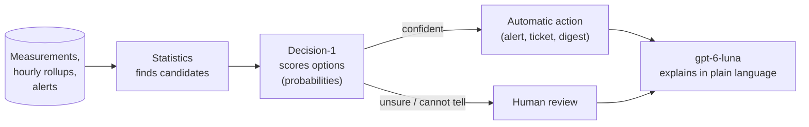
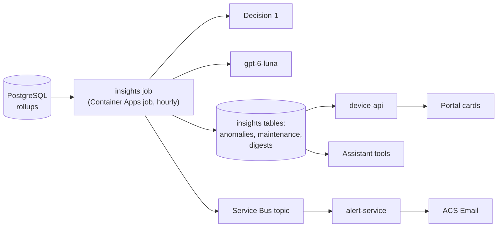

# Ideas: a smarter platform with LLMs and decision models

Brainstorm, not a plan: how the Smart Device Platform could use large language models (LLMs) and decision models to detect anomalies, anticipate maintenance, raise better alerts and explain what happens at a site. Nothing here is committed; each idea would become a PRD and an OpenSpec change.

## Three kinds of intelligence, each for what it does best

| Tool | Good at | Not good at | In this platform |
|---|---|---|---|
| **Statistics and simple ML** (SQL, Python) | Numbers over time: baselines, trends, forecasts, outliers | Context, judgement, explanations | Hourly rollups already exist (M6) — cheap to compute per device and metric |
| **Decision model** — `Microsoft-Decision-1` (Foundry, Preview, EU data zone in francecentral) | A closed question with fixed answers, returning a **calibrated probability per answer**, including "cannot tell"; classification, triage, routing, grading against a rubric, guardrails | Generating text, open questions, knowledge not given in the input | Decide *whether* something matters, *how urgent* it is and *where* it goes, with a confidence threshold |
| **LLM** — `gpt-6-luna` (already deployed) | Language: summaries, explanations, turning requests into structured settings, conversation | Exact arithmetic over long series; repeatable yes/no decisions with a known confidence | Explain, summarise, draft, converse |

The pattern that comes back in every idea:

Statistics keep the volume low (a few candidates instead of every measurement), Decision-1 makes a repeatable decision with a confidence that the platform can threshold, and the LLM only writes text for the few cases a person will read.

## Ideas

### 1. Anomaly detection with triage

- **What:** find unusual readings without a threshold set by hand, and tell real problems from sensor faults.
- **How:**
  1. *Statistics*: per device and metric, a baseline from the last 7–30 days of hourly rollups (median, spread, daily profile); flag readings far outside it, flat lines (stuck sensor), jumps and gaps.
  2. *Decision-1*: "Given this device, its site, the recent series summary and its neighbours on the same site, what is this? **real environmental event / sensor fault / expected pattern / cannot tell**" — with probabilities.
  3. Above a confidence threshold, raise an "anomaly" alert through the existing M5 pipeline; below it, list it for review in the portal.
- **Demo value:** the simulator already injects anomalies (`SDP_SIM_ANOMALIES`) and corrupted data. The audience sees the platform notice a cold room warming up *and* say "probably a real event, 92 %", while a device stuck at the same value is classified as a sensor fault.

### 2. Predictive maintenance

- **Battery:** fit the decline of `battery_voltage` / `battery_level` per device (linear or piecewise on daily rollups) and estimate the days left before the device stops reporting. The fleet summary endpoint already returns first and last values.
- **Devices about to go silent:** growing gaps between messages, more rejected (corrupted) messages, falling transmission power.
- **Decision-1:** "Will this device need an intervention within 7 days? yes / no / cannot tell", from the computed features → a **maintenance queue sorted by probability**, so the field team visits the most likely failures first.
- **LLM:** drafts the work order ("Replace the battery of *Lyon cold room* (lyon-01-cayenne-001); at the current rate it stops in about 6 days").

### 3. Advanced alerting

| Today (M5) | Smarter |
|---|---|
| Fixed min/max per metric and device | Thresholds learned from the baseline (idea 1), or relative ("10 % above the site average") |
| One condition | Combined conditions: "temperature above 8 °C **for more than 10 minutes** while the door sensor is open" |
| Same email for every breach | **Triage by Decision-1**: severity (critical / warning / informational), actionable or noise, and the right recipient group (routing) |
| Template email | **LLM-written email**: what happened, since when, neighbouring devices, similar past alerts, suggested first action — with links to the device page |
| Thresholds edited in a form | **Natural-language rules**: "alert me if a Paris freezer goes above −15 °C for 10 minutes" → the LLM proposes a structured threshold, the user confirms it in the existing dialog |
| Flapping alerts on noisy sensors | Decision-1 judges "same incident or new incident?" to merge repeats |

### 4. Site insights

- **Daily or weekly site digest** (a Container Apps job): fleet status, metric summaries, alerts, anomalies and maintenance queue of a site, turned by the LLM into a one-page brief with citations ("Marseille: all 10 devices reporting; humidity 6 points above last week; one battery to replace this week"). Sent by email (ACS, already there) or shown as a card on the site page.
- **"What changed since yesterday?"** in the assistant, backed by a tool comparing two periods.
- **Site comparison**: the assistant already compares metrics across sites; a digest can highlight the outliers automatically.

### 5. A more trustworthy assistant

- **Online grading** with Decision-1: for each answer, "is every figure supported by the tool results? yes / partly / no / cannot tell" → a groundedness rate in the workbook, and answers below a threshold flagged in the panel ("Check the sources").
- **Routing**: "simple look-up or analysis?" → simple questions to a cheaper, faster model, complex ones to `gpt-6-luna` (lower cost and latency).
- **Guardrail for future write actions**: if the assistant is ever allowed to propose changes (e.g. a threshold), Decision-1 scores the proposed tool call against a policy before the user is asked to confirm it.

### 6. Data quality

- Classify **rejected messages** (unknown format, truncated, wrong site…) and spot new device types in the field.
- Detect **sensor drift**: two devices in the same room slowly diverging.
- Suggest **device names and locations** from patterns (the LLM drafts, an editor confirms).

## Where it fits in the architecture

- One new **insights job** reuses the existing pieces: rollups (data), Service Bus and the alert service (delivery), the portal and the assistant (presentation), Application Insights (tracing every model call).
- Same principles as today: managed identity to Foundry, EU data zone, read-only access to measurements, every automated decision recorded with its probabilities and model version, and a human for anything consequential.

## Suggested order

| # | Idea | Demo value | Effort | Builds on |
|---|---|---|---|---|
| 1 | Anomaly detection with Decision-1 triage, explained alerts | Very high: visible and live, uses the simulator's anomalies | Medium | M5 alerting, M6 rollups |
| 2 | Site digest (email and portal card) | High: one page per site for managers | Low–medium | M6 fleet summaries |
| 3 | Battery forecast and maintenance queue | High for operations audiences | Medium | Rollups; a faster simulated battery decline |
| 4 | Decision-1 grading and routing for the assistant | Medium: trust and cost story | Low | M6 |
| 5 | Natural-language thresholds and combined conditions | Medium | Medium–high | M5 |

## Risks and open questions

- **Decision-1 is in Preview** (catalog: version 1 retires on 2027-02-04, maximum capacity 3): keep it behind an interface so another scorer (e.g. an LLM with a fixed-choice prompt) can replace it.
- **Calibration must be checked on our data**: a small labelled set (simulated anomalies are labelled by construction) gives reliability curves before choosing thresholds.
- **Cost and volume:** statistics first, models only on candidates; tokens and calls shown in the operations workbook.
- **Responsibility:** decisions about devices, not people — within the model's intended use; actions stay suggestions or alerts, never automatic changes.
- **Questions for the product owner:** which audience matters most for the customer (operations, site managers, executives)? Should the platform ever *act* (e.g. change a threshold) or only advise? Which language(s) for digests and emails?
